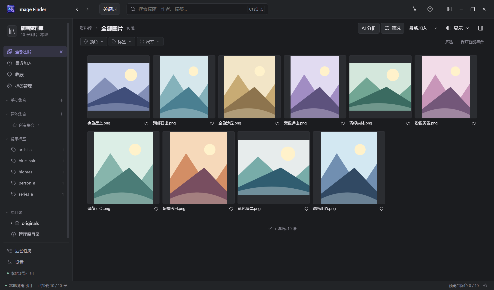
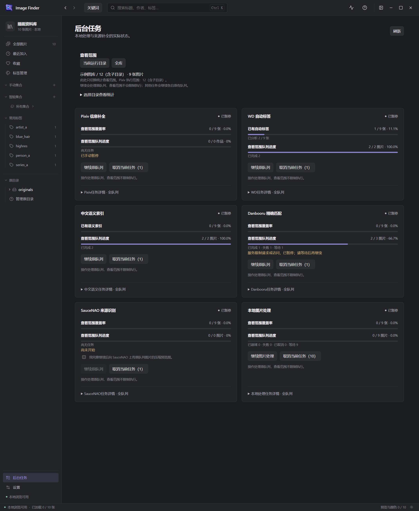

# Image Finder

Windows 本地图片管理工具，按原目录浏览与整理图片，支持标签筛选、图片预览、来源补全和本地 AI 搜索。



## 安装

在 [Releases](https://github.com/qing-yi-5427/image-finder/releases/latest) 下载 Windows x64 安装包，运行安装向导。

安装包不附带 AI 模型；在“设置 → 本地 AI 环境与配置”中安装本地 AI 环境后，可使用 WD 自动标签与中文语义搜索。首次安装需联网下载约 2.3 GB，并预留至少 5 GB 空间；支持失败后重试及模型断点续传。下载需要访问 Python、PyTorch、PyPI、Hugging Face 和 GitHub，可使用 Windows 系统代理。已有完整离线便携包仍可直接运行。

## 功能

- 原目录树、组合筛选、标签与集合，保留原文件位置，自动跳过以点开头的目录。
- 可缩放与拖动的图片预览、批量选择和文件操作。
- WD 自动标签、中文标签显示和中文画面描述搜索，本地运行。
- Pixiv、Danbooru 与 SauceNAO 来源补全，后台任务可暂停、恢复和取消。

<details>
<summary>查看后台任务界面</summary>



</details>

扫描和 AI 分析只读取原图。移入回收站等文件操作由用户明确触发。网络来源功能需对应服务可用；SauceNAO 需自行配置密钥。

## 开发

需要 Windows x64、Node.js 24 与 npm。

```powershell
npm ci
npm run check
npm run dev
```

`npm run installer` 生成按需下载模型的 NSIS 安装包；`npm run package` 生成便携目录（本地已有 `ai-runtime` 时包含离线模型）。`npm run package:smoke` 检查便携程序基本启动。

设置页可查看 AI 模型版本、位置和占用，调整分析阈值与推理设备，并在明确确认后清理独立 AI 环境；已有标签、语义索引、图库与原图保留。

缓存默认保存在用户目录，可在设置中选择其他磁盘；应用在所选位置创建独立隐藏缓存目录，切换时校验迁移，数据库与 AI 环境位置不变。

默认索引与 AI 下载保存在应用用户数据目录。开发时可用 `IMAGE_FINDER_DATA_DIR` 指定独立索引位置，打包程序也支持 `--data-dir=<目录>`。

截图使用专门生成的演示图片，不包含个人图库。第三方组件、模型与词表的许可见 [第三方声明](THIRD_PARTY_NOTICES.md)。本仓库公开源码，未授予项目整体开源许可证。
